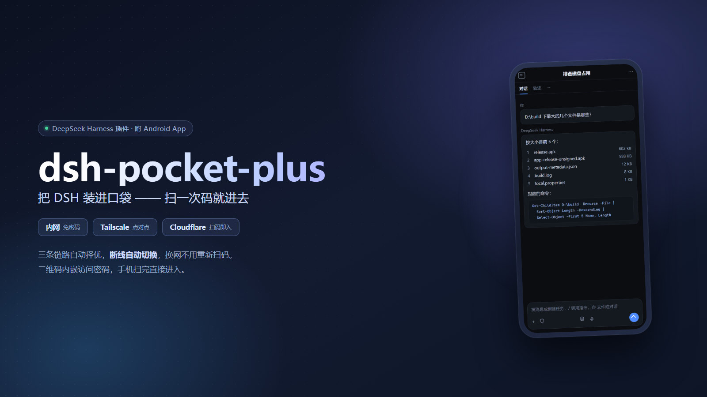
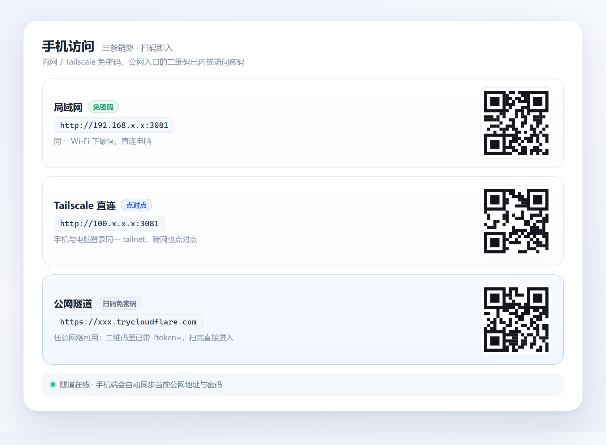
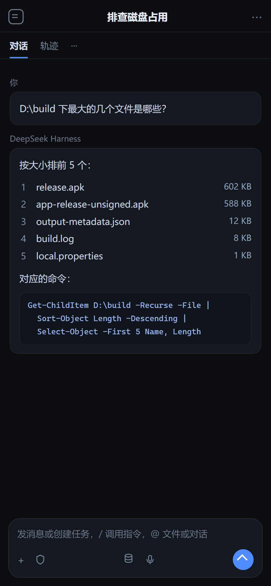
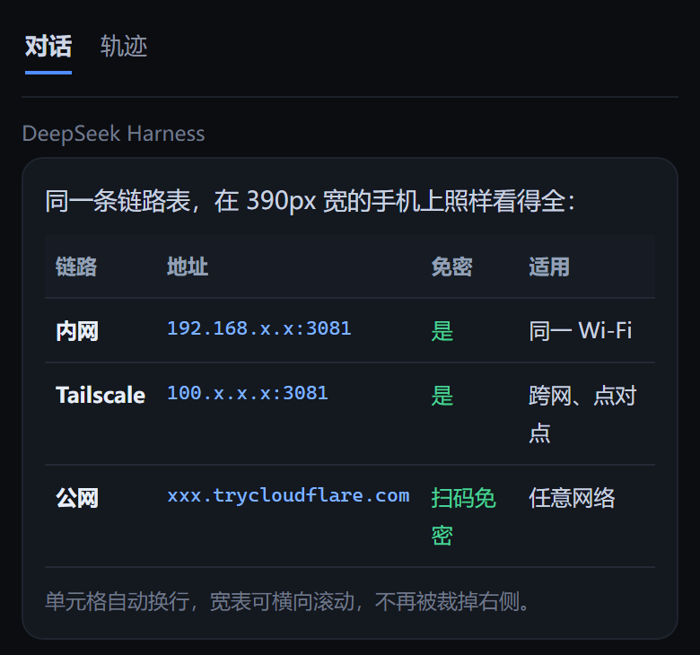
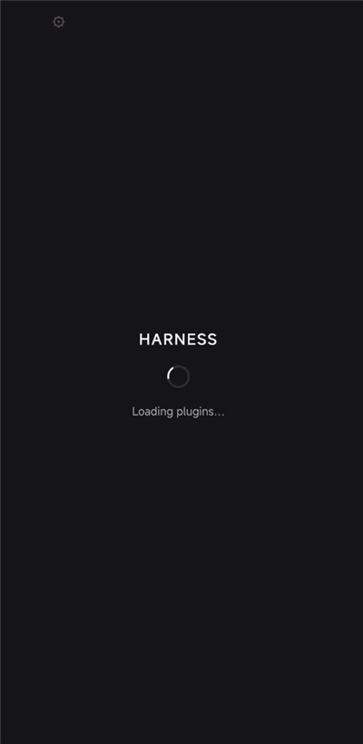

<div align="center">


<h1>dsh-pocket-plus</h1>

<p><strong>把 DeepSeek Harness 装进口袋 —— 扫一次码就进去。</strong></p>

<p>在手机上继续会话、盯住流式输出、回答问题与审批、下载产物。<br />
内网 / Tailscale / Cloudflare 三条链路自动择优，断线自动切换，切换不用重新扫码。</p>

<p>
  <a href="https://github.com/Mrsirlila/dsh-pocket-plus"></a>
  
  
  
  <a href="LICENSE"></a>
</p>

</div>

> **dsh-pocket-plus** 是 [shaobeichen/dsh-pocket](https://github.com/shaobeichen/dsh-pocket) 的增强发行版。插件本体仍是那个插件（包名 `dsh-pocket`），我们在它上面打了六处补丁，并配了一个能自动择优三条链路的安卓 App。
>
> **English** — An enhanced build of the dsh-pocket plugin for DeepSeek Harness: the access PIN is embedded in the QR code so scanning enters directly, a read-only `/dsh-pocket/entry.json` lets the phone app sync the current public address, and the companion Android app probes LAN / Tailscale / Cloudflare in order and fails over automatically.

<p align="center">
  
</p>

## 目录

- [为什么会有这个版本](#为什么会有这个版本)
- [三条链路](#三条链路)
- [和上游的差异](#和上游的差异)
- [界面预览](#界面预览)
- [快速开始](#快速开始)
- [安装](#安装)
- [扫码为什么不用输密码](#扫码为什么不用输密码)
- [常见问题](#常见问题)
- [升级与自愈](#升级与自愈)
- [安全模型](#安全模型)
- [仓库结构](#仓库结构)
- [开发](#开发)
- [反馈与贡献](#反馈与贡献)
- [License](#license)

## 为什么会有这个版本

上游把「手机上用 DSH」这件事做到了能用。真正拿它当日常入口之后，剩下的是几件很具体的麻烦：

- **扫完码还要再输一遍密码。** 二维码里只有地址，密码得跟着地址一起带着走才行。
- **公网地址每次重启都变。** 手机里存的旧地址直接 `ERR_NAME_NOT_RESOLVED`，得回电脑前重新扫一次。
- **手机离开家就回不去。** 内网地址在外面不通，公网绕一圈又慢，中间没有一个更近的选择。
- **DSH 重启之后手机黑屏。** 代理发现浏览器带着 `dsh-auth-*` cookie 就不补 launch token，旧 cookie 直接换来 401。
- **对话里的宽表格被裁掉。** 窄屏下 `overflow-x:hidden`，触屏又没有 hover，右侧那一列永远看不到。

这个版本就是把这五件事逐个补掉，并把「离开家也能连上」做成 App 里的自动切换。

> 功能介绍与更新记录视频：[BV1XaeU65EHJ](https://www.bilibili.com/video/BV1XaeU65EHJ)

## 三条链路

同一台电脑，三条路到达同一个 DSH。App 按 **内网 → Tailscale → 公网** 的顺序探测，选第一条真正通的加载，断了自动换下一条。

| 链路 | 地址形态 | 免密码 | 适用 | 速度 |
| --- | --- | --- | --- | --- |
| 内网 | `http://192.168.x.x:3081` | 是 | 手机与电脑在同一 Wi-Fi | 最快 |
| Tailscale | `http://100.x.x.x:3081` | 是 | 不同网络，手机与电脑登录同一个 tailnet | 接近内网，点对点 |
| 公网 | `https://xxx.trycloudflare.com` | 否（扫码免） | 任意网络，无需装任何东西 | 取决于 Cloudflare 中转 |

- 探测是 **TCP + HTTP 双重判定**：端口能连上还不算通，`GET /` 返回状态码 `< 500` 才算这条链路可用。
- 长按 App 顶栏的 ⚙ 可以在三个入口之间 **锁定**，锁定后不再被自动探测覆盖。
- 公网地址变了也没关系：App 连上任意一条链路时会去拉 `/dsh-pocket/entry.json`，把最新的公网地址与密码同步本地，**下次出门不用重新扫码**。
- Tailscale 那一条之所以免密码，是因为插件把 `100.64.0.0/10`（CGNAT）和 RFC1918 一并判定为「局域网」，走的是内网规则。手机要装 Tailscale 并登录同一个账号。

## 和上游的差异

插件侧六处补丁，全部只改行为、不改接口：

| # | 位置 | 改动 | 解决的问题 |
| --- | --- | --- | --- |
| ① | `lib/service.mjs` | 二维码文本追加 `?token=<PIN>` | 扫码直达，不再手输密码 |
| ② | `lib/index.js` | 新增只读路由 `GET /dsh-pocket/entry.json` | 手机同步当前公网地址与密码 |
| ③ | `lib/tunnel.mjs` | `spawn` 加 `windowsHide: true` | Windows 上弹黑框、关窗即断隧道 |
| ④ | `lib/proxy.mjs` | 上游 401 时清 `dsh-auth-*` cookie 并 302 重握手 | DSH 重启后手机黑屏 |
| ⑤ | `client/mobile/mobile.css.ts` | 表格容器可横向滚动、单元格解除最小宽度 | 宽表格右侧被裁 |
| ⑥ | `lib/service.mjs` 等 | 新增 Tailscale 卡片、`tailscaleUrl`、`tailscaleQr` | 第三条链路的入口 |

App 侧（`DSH掌上版-1.41.apk`）：

- 三入口优先级探测与自动降级、锁定入口
- 扫码分流：`100.64/10` 自动识别成 Tailscale 入口
- 连上后回拉 `entry.json` 同步三条地址
- 表格渲染、401 自愈后自动重载

## 界面预览

<p align="center">
  
  &nbsp;&nbsp;
  
</p>
<p align="center"><sub><b>左：三条链路</b> · 内网 / Tailscale / 公网各一张二维码 &nbsp;|&nbsp; <b>右：手机端会话</b> · 流式输出与代码块</sub></p>

<p align="center">
  
  &nbsp;&nbsp;
  
</p>
<p align="center"><sub><b>左：宽表格</b> · 可横向滚动，长单元格自动换行 &nbsp;|&nbsp; <b>右：冷启动</b> · 加载插件中</sub></p>

> 截图为演示数据，域名、PIN、二维码均为示例。

## 快速开始

1. **装插件**（Web profile）：

   ```bash
   dsh plugin --profile web add "dsh-pocket@github:Mrsirlila/dsh-pocket-plus#path:/plugin"
   ```

2. **重启 DSH**，侧栏打开「DSH Pocket」设置页，能看到内网 / Tailscale / 公网三块卡片。

3. **装 App**：下载 [`DSH掌上版-1.41.apk`](DSH掌上版-1.41.apk) 安装。

4. **扫码**：手机扫任意一张二维码。带密码的那张会直接进入，不用再输 PIN。

## 安装

### 插件

推荐用 GitHub 子目录安装，升级时 `pnpm update dsh-pocket` 即可：

```bash
node "<DSH 安装目录>\lib\bin.js" plugin --profile web add "dsh-pocket@github:Mrsirlila/dsh-pocket-plus#path:/plugin"
```

也可以直接在插件市场里装上游 `dsh-pocket`，再手动覆盖 `D:\deepseek\deepsleep\dsh-pocket-publish\plugin` 里的文件 —— 但那样升级会被 pnpm 换回官方版，见 [升级与自愈](#升级与自愈)。

装完检查一下补丁还在：

```powershell
$d="$env:USERPROFILE\.dsh\profiles\web\node_modules\dsh-pocket"
(Get-Item "$d\lib\service.mjs").Length      # 26509 = 补丁版；22202 = 官方原版
Select-String -Path "$d\lib\service.mjs" -Pattern 'tailscaleIPv4','qrTextFor' -SimpleMatch
```

### App

| 文件 | 大小 | 说明 |
| --- | --- | --- |
| [`DSH掌上版-1.41.apk`](DSH掌上版-1.41.apk) | 602554 B | 三链路自动择优、入口锁定、扫码分流、地址同步 |
| [`dsh-pocket插件-已打补丁.zip`](dsh-pocket插件-已打补丁.zip) | 213146 B | 插件完整源码，可离线部署 |

签名是自签名，首次安装需要允许「安装未知来源」。升级覆盖安装即可，不需要卸载（沿用同一个签名密钥）。

完整用法与更新记录见 [`使用说明.txt`](使用说明.txt)，包内容导读见 [`先读我-包内容说明.txt`](先读我-包内容说明.txt)，校验值见 [`SHA256校验.txt`](SHA256校验.txt)，插件源码见 [`plugin/`](plugin/)。


## 扫码为什么不用输密码

普通二维码里只有 `https://xxx.trycloudflare.com`，所以扫完还得手动输 PIN。这个版本把 PIN 拼进地址：

```text
https://xxx.trycloudflare.com/?token=15469936
```

代理收到带 `?token=` 的请求会：

1. 校验 PIN 是否正确；
2. 种一个 30 天有效的 HttpOnly cookie；
3. 302 到不带参数的干净地址。

第二次打开就不需要参数了。**链接里有 PIN，等同于电脑的钥匙**，别往公开群里发；泄露了就在设置页点「换一个」，旧链接立即失效。

## 常见问题

<details>
<summary><b>扫码进去还是要输密码</b></summary>

先看二维码文本里有没有 `?token=`。没有的话就是插件被换回了官方版：

```powershell
(Get-Item "$env:USERPROFILE\.dsh\profiles\web\node_modules\dsh-pocket\lib\service.mjs").Length
```

`22202` 是官方原版，`26509` 才是补丁版。用 `robocopy` 重新部署或重启一次 `start-dsh-web.cmd`（自愈脚本会自动补回）。
</details>

<details>
<summary><b>DSH 重启后手机黑屏：dsh web authentication required</b></summary>

现象：页面只有一行 `dsh web authentication required; reopen the URL printed by dsh web.`。

原因：DSH 每次启动会换 launch token，而代理发现浏览器带着 `dsh-auth-*` cookie 就不再补 token，旧 cookie 换来 401。

补丁④ 会把这种 401 变成「清掉旧 cookie 并重新握手」的 302，手机自动跳一次就进去了。如果还黑屏，下拉刷新一次，不要清 App 数据。
</details>

<details>
<summary><b>公网地址每次重启都变</b></summary>

Quick Tunnel 的域名是临时的，进程一重启就换一个。手机不用管：连上内网或 Tailscale 时会拉 `/dsh-pocket/entry.json` 把新地址同步过去。只有三条链路全都不通时，才需要回电脑前重新扫一次。
</details>

<details>
<summary><b>对话里的表格右边被切掉</b></summary>

补丁⑤ 让表格容器可以横向滑动，并把单元格的最小宽度从 `100px` 解开。如果还是被裁，确认 `client.js` 是 143769 B 的补丁版。
</details>

<details>
<summary><b>Tailscale 卡片不显示 / 显示但连不上</b></summary>

设置页的卡片依赖 `pocket.status` 里的 `tailscaleUrl`。如果卡片不在，先确认插件是补丁版（`service.mjs` 26509），再确认电脑上 `tailscale status` 能看到本机的 `100.x` 地址。
</details>

<details>
<summary><b>重启之后补丁又没了</b></summary>

pnpm 从 store 重新链接时会恢复官方文件。用 `start-dsh-web.cmd` 启动（而不是直接 `dsh web`），启动前的自愈脚本会按哈希比对：

- 是补丁版 → 跳过
- 是官方原版 → 整文件替换
- 两个都不是 → 拒绝改动并报错

详见 [`插件维护规范.md`](插件维护规范.md)。
</details>

## 升级与自愈

上游发版时，不要直接覆盖。按仓库里的 [`开工必读.md`](开工必读.md) 走：

1. 拉上游新版本到临时目录
2. 逐文件比对，把六处补丁重新打上
3. 更新 `plugin/`、重打 zip、更新 `SHA256校验.txt`
4. 部署用 `robocopy /E /PURGE`（单文件覆盖会写穿 pnpm 硬链接）
5. 推仓库 → `pnpm update dsh-pocket`

自愈脚本 `D:\tools\patch-dsh-pocket.js` 以官方原版为基线做哈希比对，只认「补丁版」和「官方原版」两种输入，避免上游换版后被乱七八糟改坏。

## 安全模型

- **访问密码**：6–8 位数字 PIN，公网入口强制校验；内网与 Tailscale 走免密规则。
- **Cookie**：登录后种 30 天 HttpOnly cookie，JS 读不到；换密码后旧 cookie 立即失效。
- **二维码**：含 PIN，等同钥匙。不要公开分享。
- **entry.json**：只读，且只暴露「地址 + 当前 PIN」，不含任何会话数据；公网访问同样要求已登录。
- **桌面设置页**：`/dsh-pocket` 只接受回环请求。
- **公网链路**：走 Cloudflare Quick Tunnel，传输层是 HTTPS；局域网与 Tailscale 是明文 HTTP，但只在可信网络内可达。

## 仓库结构

```text
dsh-pocket-plus/
├─ plugin/                  # 插件源码（六处补丁已打）
│  ├─ lib/                  # service.mjs / index.js / proxy.mjs / tunnel.mjs
│  ├─ client/               # 桌面设置页与手机端样式、文案
│  ├─ 本地修改声明.md        # GPL-2.0 §2(a) 要求的修改声明
│  └─ 安装说明-必读.txt
├─ DSH掌上版-1.41.apk       # 安卓 App
├─ dsh-pocket插件-已打补丁.zip
├─ SHA256校验.txt
├─ 使用说明.txt
├─ 先读我-包内容说明.txt
├─ 插件维护规范.md          # 上游更新流程、故障史
└─ 开工必读.md              # 每次动手前的检查清单
```

## 开发

插件侧没有构建步骤，改完直接部署：

```powershell
robocopy .\plugin "$env:USERPROFILE\.dsh\profiles\web\node_modules\dsh-pocket" /E /PURGE /NFL /NDL /NJH /NJS
node --check .\plugin\lib\service.mjs
node --check .\plugin\lib\index.js
node --check .\plugin\lib\proxy.mjs
node --check .\plugin\lib\tunnel.mjs
```

App 侧（`D:\android-build\DshPocket`，单文件 `MainActivity.java`）：

```powershell
gradle -p D:\android-build\DshPocket assembleRelease --no-daemon
# 产物：app\build\outputs\apk\release\app-release.apk
```

改完插件记得重启 DSH 才生效；重启会换掉公网域名与 PIN，属于正常现象。

## 反馈与贡献

- 上游插件本身的问题，请提到 [shaobeichen/dsh-pocket](https://github.com/shaobeichen/dsh-pocket/issues)。
- 六处补丁、App 三链路相关的问题，提到 [本仓库 Issues](https://github.com/Mrsirlila/dsh-pocket-plus/issues)。
- PR 请保持「只做必要改动」：一处补丁一个提交，并在描述里写清验证方式（扫码 / 401 探测 / 表格截图均可）。

## License

GPL-2.0，与上游 dsh-pocket 一致。对上游代码的每一处修改都记录在 [`plugin/本地修改声明.md`](plugin/本地修改声明.md)。

电脑端插件是 [shaobeichen/dsh-pocket](https://github.com/shaobeichen/dsh-pocket)（GPL-2.0）的修改副本，以 **GPL-2.0** 分发，与原作者无关；问题请提到本仓库，不要反馈给上游。界面与图标中的形象版权归其原作者所有。


